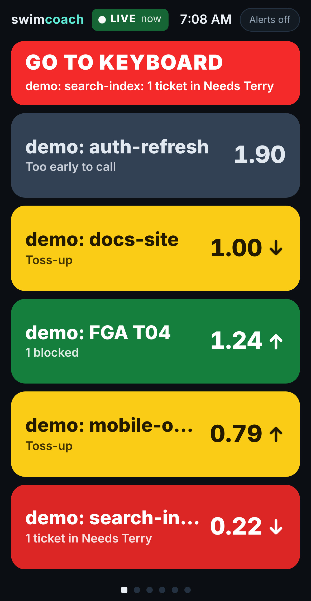

#  swimcoach

A self-hosted, mobile-first status board for agent-run software work.

Monitoring agents (one per agent-based dev system, such as Codex or Claude Code) report a snapshot of
each in-flight project every few minutes. You keep the page open on a phone or tablet and can see at a
glance whether everything is still moving and which project needs you.



> **Status:** the MVP is built and deployed (a Cloudflare Worker behind Cloudflare Access), qualified
> in [docs/qualification/](docs/qualification/README.md), and waiting on Terry's acceptance. It exists
> to find out what Terry wants; a greenfield V2 follows ([docs/concept.md](docs/concept.md) section 14).

## Agents Directed To Post Updates

If Terry pointed you here, you are a project's agent, and you put your milestone on his phone by
running the swimcoach CLI yourself. RFC 2119 keywords; the capitals are load-bearing. The full rules
are in [docs/agents/swimcoach-reporting.md](docs/agents/swimcoach-reporting.md); this section is
enough to start.

**1. Run the CLI by its absolute path.** It works from any folder, in PowerShell, cmd and Git Bash.
You MUST NOT rely on `PATH`.

| Shell | Path |
| --- | --- |
| PowerShell, cmd | `C:\Projects\swimcoach\bin\swimcoach.cmd` |
| Git Bash | `/c/Projects/swimcoach/bin/swimcoach.cmd` |

**2. Pass no address and no secret.** The CLI reads its URL and Access token from
`%USERPROFILE%\.secrets\swimcoach\cli.json` by itself. You MUST NOT pass a URL or a token, and MUST
NOT read, print or copy that file. There is no `--url` flag.

**3. Send the report as JSON on standard input**, with `report -f -`. This is the preferred form.

Git Bash (Claude Code's shell):

```bash
/c/Projects/swimcoach/bin/swimcoach.cmd report -f - <<'EOF'
{
  "agent": "claude",
  "project": "FGA",
  "milestone": "M12",
  "active_hours": 3.1,
  "cap_hours": 4,
  "lanes": {
    "ready_for_work": 0,
    "in_progress": 1,
    "needs_terry": 1,
    "ready_for_review": 4,
    "completed": 0
  },
  "needs_me": "Confirm the M12 demo build on your phone."
}
EOF
```

PowerShell:

```powershell
@'
{
  "agent": "codex",
  "project": "localswim V2",
  "milestone": "T06",
  "active_hours": 1.85,
  "cap_hours": 4,
  "lanes": { "ready_for_work": 2, "in_progress": 1, "needs_terry": 0, "ready_for_review": 3, "completed": 1 }
}
'@ | C:\Projects\swimcoach\bin\swimcoach.cmd report -f -
```

cmd (one line):

```bat
echo {"agent":"codex","project":"localswim V2","milestone":"T06","active_hours":1.85,"cap_hours":4,"lanes":{"ready_for_work":2,"in_progress":1,"needs_terry":0,"ready_for_review":3,"completed":1}} | C:\Projects\swimcoach\bin\swimcoach.cmd report -f -
```

**4. What every field holds.** Every report is complete: every field except `needs_me` is REQUIRED,
every time, and none has a default. The CLI refuses a report with any field missing, and any field it
does not know.

| Field | Holds | Allowed |
| --- | --- | --- |
| `agent` | Which agent you are | `"codex"` or `"claude"` |
| `project` | The project's stable name. The same spelling every time: a new spelling makes a second card | 1 to 64 characters |
| `milestone` | The milestone's name, spelled the same every time | 1 to 32 characters |
| `active_hours` | Active time spent on this milestone so far, in decimal hours | 0 to 168, for example `1.85` |
| `cap_hours` | The milestone's time budget, in hours | Over 0, at most 168 |
| `lanes.ready_for_work` | Cards of THIS milestone's epic in Ready For Work | Whole number, 0 to 999 |
| `lanes.in_progress` | Cards in In Progress | Whole number, 0 to 999 |
| `lanes.needs_terry` | Cards waiting on Terry himself (a visual check, Completed, a cutover, a demo) | Whole number, 0 to 999 |
| `lanes.ready_for_review` | Cards in Ready For Review | Whole number, 0 to 999 |
| `lanes.completed` | Cards in Completed | Whole number, 0 to 999 |
| `needs_me` | Optional. One sentence saying exactly what Terry must do. Leave the field out when there is no ask; MUST NOT be empty | 1 to 200 characters |

Count only this milestone's epic, never the whole board.

**5. Or use flags instead of JSON.** Give EITHER `-f` OR every field flag; the CLI refuses a mix. Put
a space between each flag and its value. `swimcoach.cmd help report` lists every flag.

```bat
C:\Projects\swimcoach\bin\swimcoach.cmd report --agent codex --project "localswim V2" --milestone T06 --active-hours 1.85 --cap-hours 4 --ready-for-work 2 --in-progress 1 --needs-terry 0 --ready-for-review 3 --completed 1
```

The same with short forms: `-a codex -p "localswim V2" -m T06 -u 1.85 -b 4 -w 2 -i 1 -t 0 -r 3 -d 1`,
and `-q "..."` for `--needs-me`.

**6. Check without sending:** add `-n` (`--dry-run`). It prints the JSON it would send and reads no
config.

**7. When to report.** You MUST NOT report more often than once every 5 minutes for the same
milestone. You MUST report at milestone start, after a card moves (once 5 minutes allow), and as a
heartbeat at least every 10 minutes while you work. Silence for 25 minutes turns the card gray.

**8. Stop only when Terry says the milestone is complete.** It deletes the milestone and its history:

```bat
C:\Projects\swimcoach\bin\swimcoach.cmd stop -p FGA -m M12
```

**9. Exit codes.** You MUST NOT retry in a loop; a failure MUST NOT stop your real work.

| Exit | Meaning | What you do |
| --- | --- | --- |
| 0 | Sent, stopped, or a valid `-n` | Carry on |
| 2 | Usage or validation error | Fix the command from the message; run it once more |
| 3 | `stop` for a milestone that is not tracked | Check the spelling; do not retry blindly |
| 4 | The server refused the body | Fix it from the printed problems; run it once more |
| 5, 6 | Authentication or config file problem | Stop reporting and tell Terry once; it is his to fix |
| 7 | Server unreachable | Do nothing special; your next report replaces it |
| 1 | The CLI itself failed | Carry on; mention it to Terry |

## Start here

- **[AGENTS.md](AGENTS.md)**: working agreements and the mock workflow, for any agent working here.
- **[docs/concept.md](docs/concept.md)**: the full concept, including the problem, displays, card
  rules, RTR math, the localswim lane mapping, the architecture, the decisions and their reasons, open
  questions, and what's out of scope.
- **[mocks/index.html](mocks/index.html)**: the clickable mock. It's one self-contained file: open it in
  a browser (phone or desktop) and switch scenarios to see each state. It needs no server.
- **[docs/img/](docs/img/)**: screenshots of every display, rendered from the prototype on sample data
  at iPhone 16 size.
- **[reference/prototype/](reference/prototype/)**: the prototype from the design conversation. It's
  kept so it can be run and read, not as the codebase going forward.

## In one paragraph

Agents POST per-project lane counts and hours to the server. The server computes **RTR** (share of
tickets Ready for Review ÷ share of the time block used), a five-bin trend, a projection, and the
chance of landing inside the block, and holds back a verdict while history is thin. The phone shows a
ruthlessly minimal row of project cards (green, yellow, red only for *Needs Terry*), a GO TO KEYBOARD
banner when Terry has to act, one swipe-over detail display per project, and a LIVE indicator so a
stalled feed never reads as all-good.

## Data source

Project status comes from [localswim](https://github.com/localswim/localswim), a swimlane board that
agents update through its CLI.

## License

[MIT](LICENSE) for swimcoach's own code.

## Credits

Text is set in the [Inter](https://github.com/rsms/inter) typeface by Rasmus Andersson and The Inter
Project Authors, under the SIL Open Font License 1.1. See [THIRD-PARTY-NOTICES.md](THIRD-PARTY-NOTICES.md).
