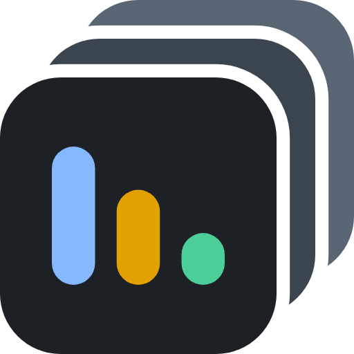

# The swimcoach mark

**The localswim mark, unchanged, on a stack of two boards stepping up and right.** swimcoach watches many
localswim boards, so its mark is a stack of them. Chosen by Terry on 2026-11-13 (candidate S1).

| File | What |
|---|---|
| `swimcoach.svg` | **The one definition.** Everything else is generated from it |
| `swimcoach-512.png` | 512 × 512, transparent corners and gaps |
| `swimcoach-touch-180.png` | iPhone home-screen icon: 180 × 180, full bleed on `#0b0f14`, since iOS rounds the corners and ignores SVG icons |
| `candidates*.png` | The design rounds that led here, kept so a rejected idea is not rebuilt |

## How it is built

In a 32 × 32 viewBox:

- **The front board is localswim's mark exactly**, scaled by 25/32: ground `#1D2125`, bars `#85B8FF`,
  `#E2A100`, `#4BCE97`, which measure 7.94, 7.20 and 8.16:1 on that ground (localswim's own measurement,
  `src/localswim/api_endpoint.py`).
- **Two boards behind it**, `#3B4550` then `#5A6573`, each 25 units square and stepping 3.5 units up and
  right. The name for the pattern is a *stack* or *cascade*.
- **Each back board has a 1.2-unit gap masked out** around the board in front of it, so the layers stay
  separate on dark and light tab bars alike, without depending on the background color.

## Rules carried over from localswim

- **One definition.** `mocks/tools/embed-logo.py` writes the SVG into the mock as the favicon and as the
  header's `--brand` image, and writes the touch icon PNG. Nobody pastes the SVG anywhere by hand.
- **Every `#` in a data URI MUST be percent-encoded**, or the URI ends at the first color. `embed-logo.py`
  does this with `urllib.parse.quote`.
- **The bars keep equal weight.** A recolored bar MUST land between 7.2 and 8.2:1 on `#1D2125`, or one
  bar of three recedes. That is the failure localswim's first, darker blue had.

RFC 2119 keywords; the capitals are load-bearing.

## Regenerating

    uv run --no-project --with playwright --with pillow python mocks/tools/render-logo.py
    python mocks/tools/embed-logo.py

## Rejected along the way

- **Sideways lanes, progress bars, rising bars** (`candidates.png`): did not say "many boards". Rising bars
  also read as a phone's signal-strength icon.
- **Speed streaks** (`candidates-multi-board.png`, F and G): the streaks shrink to dim dots at 16 px.
- **Bars on the back board** (`candidates-family-colors.png`, D1): only stray specks peek out at 16 px.
- **A swimcoach color trio** (violet `#B3A1FF`, coral `#FF8F70`, teal `#2CC9B2`, all 7.3 to 7.8:1) and a
  violet stack (`candidates-stack.png`, S2 and S3): measured and kept on file, but Terry chose the plain
  gray stack.
