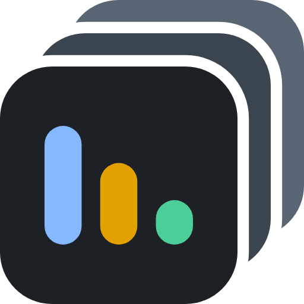

# swimcoach brand guide

Started 2026-11-13. It records what Terry has chosen, with the measurements behind each choice, so the
app, the docs and any later surface stay one family with each other and with localswim. RFC 2119
keywords; the capitals are load-bearing.

**Status of each section:** *Settled* means Terry chose it. *Open* means it is waiting on him.

## 1. The family

swimcoach is a sibling of [localswim](https://github.com/TerryOtt/localswim): localswim is the board,
swimcoach watches many boards. The family shows in three shared things: the localswim mark, the
localswim bar colors, and the Inter typeface. A new surface SHOULD reuse one of those before it invents
anything.

## 2. The mark (settled)

The localswim mark, unchanged, on a stack of two gray boards stepping up and right. Full construction,
regeneration commands and rejected ideas: [`design/logo/README.md`](../design/logo/README.md).

- `design/logo/swimcoach.svg` is the **one definition**. Every other copy MUST be generated from it.
- The mark MUST NOT be recolored, redrawn, outlined or placed on a busy background.
- Minimum size: 16 px, the browser tab. It was tested there on dark and light tab bars.
- In the status line the mark is 26 × 26 px, 8 px from the wordmark. (Screen-part names, such as
  status line, card display area, title line and detail blurb, are defined in `docs/concept.md`
  section 2.)
- The iPhone home-screen icon is `swimcoach-touch-180.png`: full bleed on `#0b0f14`.

## 3. The wordmark (settled)

- Always one lowercase word, **swimcoach**, set in Inter 700, with `letter-spacing:.02em` in the status line.
- **Two tones: "swim" in lane blue `#85B8FF`, "coach" in lane amber `#E2A100`.** Both are the mark's own
  bar colors, so the word and the mark read as one identity. Terry chose this (W2) on 2026-11-13: it
  "pops so well and looks very deliberate/intentional without being in your face about it."
- On the page ground `#0b0f14`: blue 9.42:1, amber 8.54:1. Both clear AAA.
- **"swim" is localswim's wordmark blue**, so the word the two products share wears the same color in
  both.
- The wordmark colors MUST come from the brand colors (section 5), never the status colors.
- **"coach" amber and the attention yellow are deliberately "visually related but emotionally
  distinct"** (Terry, 2026-11-13). In his words, coach "feels warm and inviting", while the yellow card
  means "hey you should pay more attention here. It isn't _bad_ but it is slipping in a direction you
  want to know about." The two MUST stay related and MUST NOT be merged. What keeps them apart is
  measurable: lane amber `#E2A100` is darker and more orange (hue 43°, lightness 44%) and only ever
  appears as small text in the status line. The attention yellow `#facc15` is brighter (hue 48°,
  lightness 54%) and only ever appears as a large card fill. A change that moves either one toward the
  other, or uses amber as a fill or yellow as text in the status line, would erase the distinction.
- The other candidates are in `design/logo/candidates-wordmark.png`. Green "coach" (W1, W4) was set aside
  because it sits beside the green LIVE box, two different greens touching.

## 4. Typeface (settled)

**Inter**, v4.1, Latin subset, embedded in the page. Credit and license: `THIRD-PARTY-NOTICES.md` and
`third_party/inter/`. Numbers that change in place (RTR, counts, times) use `font-variant-numeric:
tabular-nums` so they do not jitter.

## 5. Color

The palette has three parts: **four core brand colors**, a **neutral ramp**, and **status colors**. Every
color in the page MUST come from a token in `mocks/index.html` `:root`, and the token MUST be listed
here. A new hex needs a reason written in this section first. Applied 2026-11-13, when the mock's 45
one-off colors were folded into these tokens.

### Core brand colors (settled)

Four colors, all from the mark, which is the usual 4 ± 1 for a brand. Measured on the mark's ground by
localswim:

| Token | Name | Hex | On `#1D2125` | Used for |
|---|---|---|---|---|
| `--lane-blue` | Lane blue | `#85B8FF` | 7.94:1 | "swim" in the wordmark, the bell when alerts are on, mock controls |
| `--lane-amber` | Lane amber | `#E2A100` | 7.20:1 | "coach" in the wordmark |
| `--lane-green` | Lane green | `#4BCE97` | 8.16:1 | Good news, through `--ok` (below) |
| `--board` | Board slate | `#1D2125` | (ground) | The mark's board, raised surfaces, the done card, the desktop phone frame |

### Neutral ramp (settled)

One slate ramp, darkest to lightest. It includes the mark's back boards, so the page's grays and the
logo's grays are the same grays.

| Token | Hex | Used for |
|---|---|---|
| `--bg` | `#0b0f14` | Page |
| `--panel` | `#131a22` | Tiles, the mock's scenario sheet |
| `--panel2` | `= --board` | Health box when idle, bar tracks |
| `--line` | `#243140` | Borders, dividers, parked lanes |
| `--stack-1` | `#3B4550` | The "too early" gray card; the mark's middle board |
| `--stack-2` | `#5A6573` | Lane shades; the mark's back board |
| `--faint` | `#5f7082` | Axis labels, footers (3.78:1, deliberately quiet) |
| `--dim` | `#93a3b3` | Secondary text; done (7.44:1 on `--bg`) |
| `--text` | `#e8eef4` | Primary text (16.44:1) |

### Status colors (settled in part)

**Every status color is a call to action, and relaxing is an action.** Terry, 2026-11-13: "I like color
to push me to action -- and 'relaxing' is an action." A status color MUST name what Terry should do,
not just describe a state. Status colors MUST NOT be used for decoration.

| Color | Action it asks for |
|---|---|
| Green (LIVE, on-time card) | **Relax.** Look away; this is safe to ignore for now |
| Yellow (needs attention) | **Keep an eye on it.** Not bad, but slipping in a direction worth knowing |
| Red (GO TO KEYBOARD) | **Get up.** Only Terry can move this |
| Gray (too early to call) | **Nothing yet.** There is not enough history to judge, so do not try |
| Slate (done) | **Nothing.** It is finished |
| Orange / red health box (STALE, OFFLINE) | **Distrust the page.** Everything below is old |

This is the same rule as the build-chain banner in Terry's global setup: loudness tracks what he can act
on. A color that asks for no action, or for an action he cannot take, wears out the reflex.

| Token | Meaning | Fill | Text on it | Contrast |
|---|---|---|---|---|
| `--ok-fill`, `--ok` | Good news: LIVE, on time | `#1B6445` | white, full opacity | 7.11:1, AAA |
| `--risk` | Needs attention: toss-up, running late, silent agent. Not bad, but slipping in a direction Terry wants to know about | `#facc15` | `#231a00` | 11.25:1 |
| `--bad-fill`, `--bad` | Needs Terry | `#dc2626` | white | 4.83:1, **not yet AAA** |
| `--done` (`= --dim`) | Finished | `--board` card | `--dim` | 6.32:1 |

- **Color follows message: same message, same color; different message, different color.** This is
  the principle behind both the greens and the amber (section 3).
- **The LIVE box and the green cards share one green because they say the same thing: you can stop
  worrying.** Terry, 2026-11-13, in his words. LIVE: "hey relax this legit is fresh data, I know Terry
  has scars from stale dashboards showing good data when the system was actually on fire so I'm telling
  you stop worrying my dude." A green card: "current value is good plus trend is where it needs to be
  to safely ignore for now." Two shades of green here would claim two different messages, and that is
  why the eye read the old pair as a mistake.
- **Good news is lane green.** `--ok` is `--lane-green` itself, for green text on the page (9.68:1).
  `--ok-fill` is the same hue darkened until pure white on it measures 7.11:1. Light and dark, they are
  one green. A second green MUST NOT be introduced.
- **Green MUST only ever mean "safe to ignore".** It MUST NOT be used for decoration, or for anything
  merely positive that still wants a look. That is what keeps it trustworthy, and the LIVE box only works
  if it never says "relax" when the data is stale (concept.md section 3.1).
- **Done is quiet slate, not a color.** It used to be sky blue `#7dd3fc`, a near-twin of lane blue with a
  different meaning.
- **Two near-identical colors MUST NOT sit side by side** when they mean different things. The eye reads
  the pair as a mistake. Three such pairs were removed on 2026-11-13: two greens (`#166534` beside
  `#15803d`, then `#4ade80` against the mark's `#4BCE97`), and two blues (done sky against lane blue).
- The STALE (`#9a3412`) and OFFLINE (`#991b1b`) boxes, and the tinted warning flags, are single-use
  status shades and stay as literal values beside their rules.

### Contrast (settled)

- White on the good-news green MUST clear WCAG AAA (7:1), at full opacity. Terry, 2026-11-13.
- AAA for the other pairings is not yet required. Measured shortfalls are listed in `docs/concept.md`
  section 13 for when it is.

## 6. Motion (settled)

- The page appears once, finished: hidden until the font file and the first render are ready, then a
  single 0.2 s `ease-in` fade of the whole page. Polls MUST NOT fade or flash. Full rules:
  `docs/concept.md` section 3.4.
- Motion SHOULD be skipped under `prefers-reduced-motion: reduce`.

## 7. Voice

- The phone is "simple, at a glance". A label SHOULD be one or two words.
- US English. Sentence case for messages; capitals only for the two alarm words, **LIVE** and
  **GO TO KEYBOARD**, and the other health states.
- **On the swimcoach page, an ellipsis is the Unicode glyph U+2026, drawn in Inter.** Terry,
  2026-11-13: "No glyph is best let's use Inter or browser version for that it'll look cleaner", and
  "intent of '...' when talking swimcoach is that Unicode glyph". This covers CSS truncation
  (`text-overflow`, `line-clamp`) and any ellipsis in a label, such as the health box's brief waiting
  state. The glyph is in the vendored Latin subset (General Punctuation), so it renders in Inter, not a
  fallback font.
- **This is a swimcoach exception to Terry's global three-periods rule, and it is narrow.** It covers
  only what the page draws. Source code MUST still not contain the literal character: write `&hellip;`
  in markup and `'…'` in JavaScript. Docs, commit messages and conversation keep three periods.
  When Terry writes "..." about the swimcoach UI, he means the glyph.
