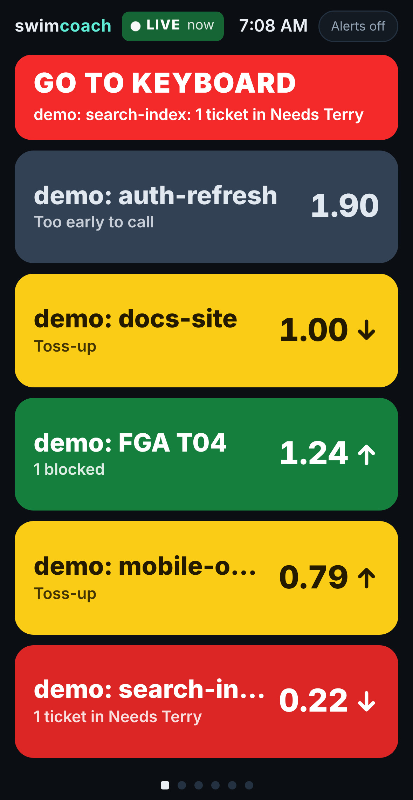
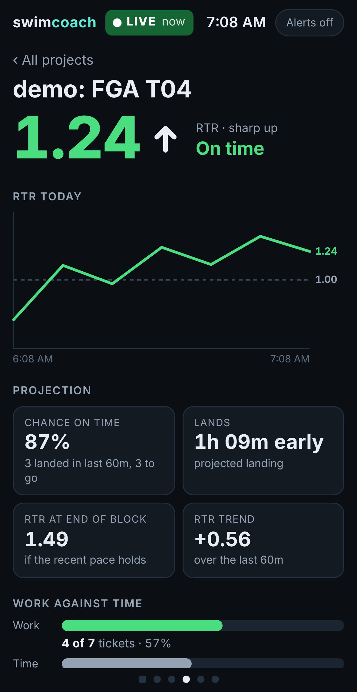
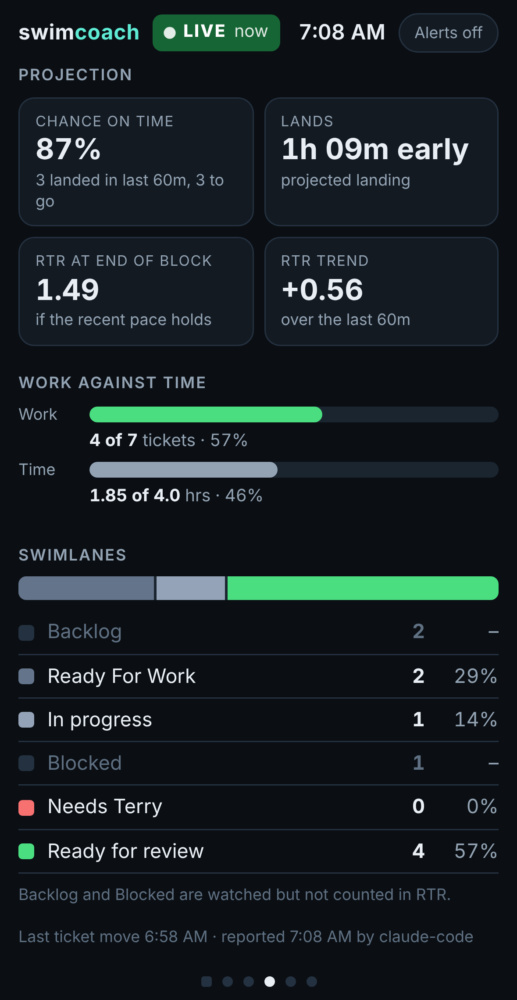
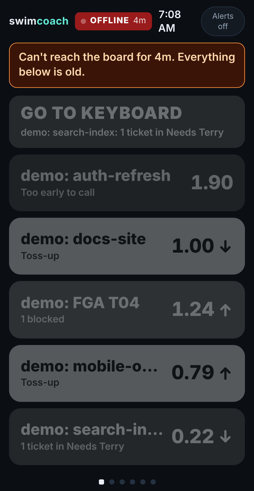

# swimcoach: concept and knowledge transfer

Knowledge transfer written 2026-11-13 by the Claude chat that designed swimcoach with Terry (the
"Architecture chat"), for the chat that builds it in this repo. Everything here comes from that one
conversation. It was brought into the repo with file paths updated and a screenshots section added
(section 0.1). Nothing has been built for v1 yet.

## 0. Read this first: what exists and what does not

- **A working prototype exists.** Its complete source is in [`reference/prototype/`](../reference/prototype/).
  Terry called this earlier work a "super prototype" and chose to start fresh, so treat it as a
  reference implementation and a spec you can run, not as code you must keep.
- **How far it was tested:** only in a Linux cloud sandbox, with sample data from `demo.py`, viewed in
  headless Chrome at iPhone 16 size. It has never run on Windows, on the QNAP, in Docker, on a real
  iPhone, or with a real monitoring agent. The swipe gesture was never tried with a finger.
- **Reference files** (all current, none superseded):

| File | What it is |
|---|---|
| `reference/prototype/server.py` | Whole back end: API, SQLite, trend, projection and chance math |
| `reference/prototype/static/index.html` | Whole front end; the source of every display |
| `reference/prototype/demo.py` | Sample data: five projects, one per card state |
| `reference/prototype/AGENT_PROMPT.md` | Text for each monitoring agent's scheduled task |
| `reference/prototype/Dockerfile`, `docker-compose.yml` | Container setup for the QNAP (never built) |
| `reference/prototype/render-displays.py` | Renders every display to PNG; this is the "mockup source" |
| `reference/prototype/README.md` | The prototype's own README |

- **There are no static mockups, diagrams, SVGs or Mermaid files.** Every picture Terry saw was a
  screenshot of the real page running on demo data. The screenshots below were made the same way.
- **Earlier designs were overwritten** as the page evolved; their source was not kept. Section 9
  describes them so nobody rebuilds a rejected idea.

### 0.1 Screenshots

Rendered 2026-11-13 from the prototype on `demo.py` data: headless Chrome, 393 × 760 CSS px at 3×
(1179 px wide, iPhone 16 native), stamped at 300 DPI. To regenerate, run `server.py`, then `demo.py`,
then `render-displays.py docs/img`.

| Display 1: all projects | Project display (top) | Project display (bottom) | Header OFFLINE state |
|---|---|---|---|
|  |  |  |  |

Every project display is in [`img/`](img/), top and bottom, one per card state in the demo:

| Demo project | Card state |
|---|---|
| auth-refresh | Gray: too early to call |
| docs-site | Yellow: toss-up, RTR 1.00 but slowing |
| FGA T04 | Green: on time, with "1 blocked" |
| mobile-onboarding | Yellow: toss-up, RTR under 0.8 but climbing |
| search-index | Red: a ticket in Needs Terry, with GO TO KEYBOARD |

## 1. The problem and how Terry works today

- Terry runs several agent-based software projects at once. Each agent-based dev system has one
  **monitoring agent**; today that is one on Codex and one on Claude Code.
- Worker agents record status on **localswim**, a Trello-like swimlane board Terry is building
  (https://github.com/localswim/localswim/, Go service plus CLI plus a web UI only Terry uses). Agents
  update it through its CLI.
- Work is planned in **time blocks**: a chunk of tickets with a wall-clock allocation, for example
  "FGA T04", 4.0 hours.
- Every 10 minutes each monitoring agent runs a scheduled task. It pulls stats with the localswim CLI,
  reads the chats of the worker agents it monitors, and posts a summary to its own chat ("chatops").
  Terry keeps that chat open on his phone. A real post:

```
2026-11-11 10:29pm
Needed at keyboard: *NO*
FGA T04
* RFR / Time: 1.23 (57% / 46%)
* Tickets: 7
   * Ready for Work: 2 (29%)
   * In Progress: 1 (14%)
   * Ready for Review: 4 (57%)
* Time: 1.8 / 4.0 hrs (46%)
[Project 2+]
```

- **What he wants:** a page on his iPhone 16 Pro, 402 × 874 CSS px (sometimes a tablet), propped up while he plays video
  games on the couch, that answers at a glance "is everything still moving, and who is on the
  strugglebus". His words for the two reactions he wants: "awesome all are green, back to video game!"
  and "FGA project just popped yellow, needs investigation, why is it struggling?"
- Terry says he is not good at UI/UX and wants concepts turned into good design for him. He likes
  detail but asked to be held to simplicity on the phone.
- The project description calls it "a mobile-first monitoring and alerting solution".

## 2. Vocabulary

- **RFR:** the Ready for review swimlane. Work the agents have finished; only Terry's review remains.
- **RTR:** Terry's name for the RFR / Time ratio. `RTR = (share of the block's tickets that are
  finished) / (share of the time block used)`. 1.0 means work is exactly keeping pace with the clock.
  FGA example: 4 of 7 tickets (57%) over 1.85 of 4.0 hours (46%) gives 1.24.
- **Time block:** the wall-clock allocation for a chunk of work.
- **The call:** the dashboard's verdict on whether the work lands at or before the end of the block.
- **Strugglebus:** Terry's word for a project in trouble.

## 3. The concept: displays

The site is a horizontal row of full-screen displays. Swipe left and right; dots at the bottom show
position (the first dot is square). Tapping a project card jumps to that project's display.

### 3.1 Header (on every display)

- Wordmark, **health box**, clock, "Alerts off/on" button.
- **Health box.** This was a firm requirement: "nothing sucks worse than a dashboard that says all good
  in the hood but it's because it stopped updating yesterday."

| State | When | Look |
|---|---|---|
| LIVE | The page's last poll succeeded within 30 s and the newest agent report is under 25 min old | Bold white "LIVE" on dark green, breathing dot, age of newest report once it is 1 min or older ("7m"); no age while fresher |
| STALE | Polls work, but no agent has reported for over 25 min while some project is unfinished | Dark orange box, warning text, all displays grayed to 40% |
| OFFLINE | Three polls in a row failed (30 s) | Dark red box, warning text, all displays grayed |
| IDLE | Every project reported today is done | Neutral box |
| NO DATA | No reports today | Neutral box |

- The dot's breathing animation runs a fixed 16 seconds and is restarted by each successful poll. If
  the page's script freezes, the dot stops by itself. A plain infinite animation would keep a dead page
  looking alive.
- The page polls `GET /api/state` every 10 seconds.
- **Alerts button:** when on, a new needs-you item plays a two-tone chime and calls `navigator.vibrate`.
  The page also jumps to the all-projects display. Sound needs that one tap (browser rule). iOS Safari
  has no vibration API, so on the iPhone it is chime only.

### 3.2 Display 1: all projects ("ruthlessly minimalist")

- **GO TO KEYBOARD banner.** Hidden unless a project needs Terry. Red, gently pulsing. Lists each such
  project and its ask. Tap goes to the first one.
- **One card per project.** Solid background color, project name, RTR, trend arrow. Fixed alphabetical
  order so a card never changes position; a color change in a known spot is the signal. Cards stretch
  to fill the screen.
- **The trend arrow is a clock hand.** Terry's idea, 2026-11-13. The RTR's final digit is the clock's
  center, and the arrow sits around it at the hour its trend points to: strong up at 12, up at 1:30,
  flat at 3, down at 4:30, hard down at 6. The arrow both sits at the hour and points at it. Every card
  reserves the same room on the right, so the numbers line up whichever way a hand points. Tested at
  402 px: the hand stays inside the card with at least 13 px to spare even with six cards on screen.
  Terry: "that worked _way_ better than I hoped."
- **Why: position carries the trend before the eye reads the arrow.** Terry: beside the number, the
  arrow "was visually blurring with the numerical value ... I had to 'work harder' to process the arrow
  direction. By moving it I get faster data at a glance." Up arrows now sit above the number and down
  arrows below it, so where the arrow is says up, flat or down without parsing its shape. **The arrow
  MUST NOT move back beside the number** on the overview cards.
- **The RTR and its hand are the second tier, after card color, and take the card's spare height.**
  Terry, 2026-11-13: they are "the _truly valuable_ second tier data beyond card color", and the size
  MUST NOT crowd the card edges ("don't crowd the edges just use more dead space"). The number is weight
  900 and scales with the card's height through a container query: the largest size that keeps the hand
  16 px from the card edge, between 28 px and 52 px. Measured at 402 px: 44 px with three cards (hand 28
  px from the edge), 28 px with six (15 px from the edge). A fixed 36 px had left 5 px.
- **The card's two side margins MUST match.** Terry, 2026-11-13: unequal padding "triggers the eye". The
  inked tip of a 3 o'clock hand sits exactly the card's 18 px padding from the right edge, mirroring the
  18 px in front of the project name. Measured at the ink level, it is 18.0 px on both sides at 44 px and
  at 28 px. Before, the tip was 25.3 px in. The number and hand sit in the same place on every card,
  whatever the direction, so the 12 and 6 o'clock hands sit a little in from that edge.
- **The name sits top-left; the status below it wraps to two lines and MUST NOT end in "...".** Terry,
  2026-11-13: "Rather get two lines of smaller status than '...' as the '...' defeats the purpose of the
  detail update." The status is 14 px, weight 500, two lines at most; the RTR block stays centered on
  the right. Measured at 402 px: the name's capitals start 18 px below the card edge, matching the 18 px
  to their left, and in the tightest card (102 px, six cards) a full two-line status ends 18 px above
  the bottom edge. search-index's full ask, "Pick an index strategy: per-tenant or shared", now fits.
- **No separator line between the name and the status.** Considered and declined, 2026-11-13. Size
  (24 px against 14 px), weight (800 against 500) and a 5 px gap already make the two tiers. A rule
  inside a colored card adds one more shape to scan at a glance, and it would compete with the clock
  hand at 12 o'clock on the same card. Hierarchy comes from type, not lines. The project display's large RTR still
  uses the plain arrow beside the number; whether it should follow is open.

Card states, first match wins:

| Order | State | Rule | Card shows |
|---|---|---|---|
| 1 | Done (dark slate) | Report says `status: done`, or every counted ticket is finished | Name |
| 2 | **Red** | The project has a needs-you item: a ticket in an attention lane (Needs Terry) or a `needs_me` text | Name, the ask, RTR, arrow |
| 3 | **Yellow** | Any of: agent silent over 25 min; status `blocked`; the call is "Running late"; no ticket moved in 45 min; the call is "Toss-up" | Name, one line saying which, RTR, arrow |
| 4 | Gray | Too early to call | Name, "Too early to call", RTR, no arrow |
| 5 | **Green** | Everything else, which means the call is "On time" | Name, RTR, arrow, nothing else |

- **Red is reserved for "Terry must act".** Terry: "RFW -> In Progress -> RFR are green/yellow. Needs
  Terry is red."
- A card with tickets in Blocked adds a small note such as "1 blocked" and keeps its color.

### 3.3 Displays 2 and on: one project each

Top to bottom:

1. "All projects" back link, project name.
2. RTR as a very large number in the state color, trend arrow, trend bin in words, the call in words.
3. Needs-you text and a stale-agent warning, when they apply. The agent's `tldr` if sent.
4. **RTR today:** line chart of RTR across the day, dashed line at 1.00, start and end times. Terry on
   seeing a timeline: "that timeline of RTR feels right, that is better than a snapshot."
5. **Projection:** four tiles: chance on time (with "3 landed in last 60m, 3 to go"), lands (how early
   or late), RTR at end of block, RTR trend (signed change). When it is too early, one tile says so and
   states the gates.
6. **Work against time:** two bars: tickets done of total, and hours used of allocated.
7. **Swimlanes:** stacked bar of counted lanes, then every lane with count and share. Parked lanes are
   dimmed with a dash for share.
8. Footer: last ticket move, last report time, reporting agent.

### 3.4 Loading: no render flicker

Terry's design intent, 2026-11-13. It is more implementation than design, and it is recorded now so the
build honors it. RFC 2119 keywords; the capitals are load-bearing.

- **The page MUST appear once, finished.** No flash of fallback text, no restyle when the typeface
  arrives, and no layout jump as content fills in.
- **The typeface load MUST block text rendering.** Inter's `@font-face` uses `font-display:block`, so the
  browser never draws text in a fallback font first.
- **The page MUST stay hidden until the DOM is built, the font file is ready and the first render is
  done.** The page then fades in as a whole, over **0.2 s, `ease-in`**.
- **A stuck font MUST NOT leave a blank page.** If the font file is not ready within 3 s, the page reveals
  anyway in the fallback font.
- **The fade SHOULD be skipped under `prefers-reduced-motion: reduce`.** The page then simply appears.
- **The fade happens once per page load.** The 10-second polls MUST NOT fade, blank or flash the page;
  they change only the values that changed.

The clickable mock follows the first five points; see `html.loading` and `reveal()` in
`mocks/index.html`. The mock's poll rewrites each display's HTML, which shows no visible flash in testing
but is not the "only what changed" update the real page needs.

## 4. Metrics: exact definitions

All constants below are the Architecture chat's guesses unless marked as Terry's. None has been tuned
on real data.

### 4.1 RTR

- `total` = tickets in all lanes except parked lanes.
- `done` = tickets in done lanes.
- `work = done / total`.
- `clock = hours.used / hours.allocated`. If the report gives `block.start` and `block.end` instead,
  `clock = (now - start) / (end - start)`.
- `RTR = work / clock`, defined only when `total > 0` and `clock > 0`.
- The server stores one sample `(time, work, clock, done, total)` per report.

### 4.2 Trend (the arrow)

- Take the newest sample and the sample closest to 60 minutes older (`SWIMCOACH_TREND_MINUTES`).
- `delta = RTR_now - RTR_then`.
- Terry asked for five bins: sharp up, up, flat, down, sharp down.

| Bin | Rule | Arrow |
|---|---|---|
| Sharp up | delta >= +0.20 | straight up |
| Up | delta >= +0.05 | diagonal up |
| Flat | between | right |
| Down | delta <= -0.05 | diagonal down |
| Sharp down | delta <= -0.20 | straight down |

- Known weakness: a block has five to nine tickets, so one landing moves RTR by more than 0.20. In the
  demo every arrow is a "sharp" one. Expect to widen the bins or smooth the series.

### 4.3 Projection

At the end of the block `clock = 1`, so RTR then equals the share of tickets done. "Will RTR be at or
above 1.0 at the end" is the same question as "will every ticket be done in time". Terry asked for both
directions: recovering to 1.0, and dropping below it.

- `pace = (work_now - work_then) / (clock_now - clock_then)`, floored at 0. This is the RTR of the
  recent stretch alone.
- Projected RTR at end of block: `proj = work_now + pace * (1 - clock_now)`, only while `clock_now < 1`.
- Landing point as a share of the block: `finish = clock_now + (1 - work_now) / pace` when `pace > 0`;
  `finish = clock_now` if already all done.
- Margin shown to Terry: `(1 - finish) * block length`. Positive is "1h 09m early", negative is
  "40m late". With `pace = 0` the tile says "No progress".
- Note that projecting with the whole-block average pace would just return the current RTR. Using the
  recent window is what makes the projection say something new.

### 4.4 Chance of landing on time (the "confidence")

Terry asked how to get confidence in the slope. Tickets are countable events, so:

- `k` = tickets finished in the look-back span, `span` = clock share of that span, `n` = tickets still
  to go, `left = 1 - clock_now`.
- Model: completions arrive as a Poisson process with unknown rate; Jeffreys prior on the rate. The
  count in the time left is then negative-binomial with `r = k + 0.5` and `p = span / (span + left)`.
- `chance = P(N >= n) = 1 - sum over j from 0 to n-1 of NB(j; r, p)`. `n <= 0` gives 1; no time left
  gives 0.
- Effect: 2 tickets in the last hour gives a much wider spread than 8, and the percentage reflects that.
- It is a rough guide. Real work is burstier, tickets differ in size, and a ticket that is 90% done
  counts as zero.

### 4.5 The call

| Call | Rule |
|---|---|
| On time | chance >= 70% |
| Toss-up | between |
| Running late | chance <= 30% |
| Too early to call | no trend available (below) |

### 4.6 "Too early to call"

Terry's request, in election-night terms: if the trend has too little stable history, hold off. No
trend, projection, chance or call is produced until all of these hold:

- A sample at least 45 minutes older than the newest exists (`SWIMCOACH_MIN_HISTORY_MINUTES`, default
  75% of the trend window).
- At least 4 samples lie in that span.
- At least 15% of the block has been used (`SWIMCOACH_MIN_BLOCK_USED`).

RTR alone gives no verdict in that period. Demo case: one ticket done 20 minutes into a 4-hour block
shows RTR 1.90, which means nothing.

### 4.7 Other timers

- **Stalled:** no change in any lane count for 45 minutes (`SWIMCOACH_STALL_MINUTES`). Yellow.
- **Agent silent:** a project with no report for 25 minutes (`SWIMCOACH_STALE_MINUTES`). Yellow, plus a
  warning on its display. The same 25 minutes drives the header's STALE state.

## 5. How the localswim lanes map in

Lanes on Terry's board, in order: Backlog, Ready For Work, In progress, Blocked, Needs Terry, Ready for
review, Completed. Each has a description on the board; the relevant parts are quoted.

| Lane | Board description (short) | In RTR | Dashboard effect |
|---|---|---|---|
| Backlog | Work held back or not yet scoped | No (parked) | Listed on the project display only |
| Ready For Work | Scoped, authorized work | Yes, unfinished | |
| In progress | Actively executing | Yes, unfinished | |
| Blocked | "Neither Terry nor Bot can advance until an external condition changes" | No (parked) | "1 blocked" note on the card; never changes color |
| Needs Terry | "Needs a concrete input/action only Terry can supply" | Yes, unfinished | Red card and GO TO KEYBOARD |
| Ready for review | "Only Terry review/approval remains" | Yes, finished | The RFR in RTR |
| Completed | Terry reviewed and accepted | Yes, finished | Only if the agent includes this block's completed cards |

- Terry on Blocked: "a non factor as neither Bot nor I can move them but still need to monitor (e.g.
  has the replacement hardware arrived at my front door yet?)".
- Matching is by lane name with defaults in `server.py` (`DONE_RE`, `ATTN_RE`, `PARK_RE`). A report can
  override with `done_lanes`, `attention_lanes`, `parked_lanes`.
- **Scope trap:** the board is cumulative. Terry's screenshot showed 35 cards in Ready for review and
  327 in Completed. An agent must report only the cards that belong to the current time block, as the
  chatops post already does. Whole-board counts would make RTR meaningless.

## 6. Architecture

### 6.1 Components

```
localswim (CLI) --> monitoring agent (Codex)      --\
worker chats ----> monitoring agent (Claude Code) ---+--> POST /api/report --> swimcoach server --> SQLite
                                                                                   |
                                             phone or tablet browser <-- GET / and GET /api/state (every 10 s)
```

- **Monitoring agents push.** Each one adds an HTTP POST per project to its existing 10-minute task. It
  already has the numbers.
- **Server:** one Python file, standard library only (`http.server`, `sqlite3`), Python 3.9+. Listens
  on 0.0.0.0:8787.
- **Page:** one static HTML file with inline CSS and JS, no framework, no build step.

### 6.2 API

| Method | Path | Purpose |
|---|---|---|
| POST | `/api/report` | One report object, or an array of them |
| GET | `/api/state?since=<epoch seconds>` | Everything the page renders. The page passes local midnight, so only today's projects and samples come back |
| DELETE | `/api/projects/<name>` | Remove a project with its samples and events |
| GET | `/healthz` | Liveness |
| GET | `/` | The page |

### 6.3 Report schema

Minimal report, which is all an agent needs to send:

```json
{
  "source": "codex",
  "project": "FGA T04",
  "hours": { "used": 1.85, "allocated": 4.0 },
  "lanes": { "Backlog": 0, "Ready For Work": 2, "In progress": 1, "Blocked": 0, "Needs Terry": 0, "Ready for review": 4 }
}
```

| Field | Required | Meaning |
|---|---|---|
| `project` | Yes | Display name and, lowercased, the key. A changed name is a new project |
| `source` | No | Which agent system; shown in the footer |
| `hours.used`, `hours.allocated` | One of hours or block | Wall-clock hours spent and allocated |
| `block.start`, `block.end` | | ISO 8601 with offset; alternative to `hours` |
| `lanes` | One of lanes or cards | Object of lane name to count, in board order (or a list of `{name, count}`) |
| `cards` | | List of `{id, title, lane, blocked, needs_me, note}`; lane counts are derived if `lanes` is absent |
| `needs_me` | No | `true` or one sentence. Raises red by itself. If absent and an attention lane has tickets, the server fills in "1 ticket in Needs Terry" |
| `status` | No | `on_track`, `at_risk`, `behind`, `blocked`, `done`. If absent the server derives it from RTR (>= 1 on track, >= 0.8 at risk, else behind; all done is `done`) |
| `tldr` | No | Summary line for the project display |
| `done_lanes`, `attention_lanes`, `parked_lanes` | No | Override the name matching |
| `events` | No | Extra log lines `{text, kind, ts}` |
| `at` | No | Timestamp of the snapshot if not now. Exists so `demo.py` can backdate history |

Per project, `/api/state` returns the stored snapshot plus `updated_at`, `stale`, `last_move_at`,
`trend` (`delta`, `minutes`, `pace`, `proj`, `finish`, `recent_done`, `to_go`, `chance`, or null when too
early) and `spark` (list of `[time, RTR]`, at most about 80 points). Top level: `now`, `last_report_at`,
the threshold settings, and `events`.

### 6.4 Storage

SQLite file, WAL mode, default `data/swimcoach.db`.

- `projects(key, snapshot JSON, updated_at)`: latest snapshot per project.
- `samples(key, ts, work, clock, done, total)`: one row per report; feeds trend, projection and the
  timeline.
- `events(id, ts, project, source, kind, text)`: activity log derived by diffing consecutive snapshots.
- Samples and events older than 14 days are deleted (`SWIMCOACH_KEEP_DAYS`).

### 6.5 Hosting

- Terry's choice: self-hosted on the LAN, on the dev box or the QNAP NAS (which has VM and container
  hosting).
- Dev box: `python server.py`. Terry's machines are Windows and he prefers cmd over PowerShell.
  Settings are environment variables (`set SWIMCOACH_PORT=8787`).
- QNAP: `docker compose up -d --build` with the Dockerfile and compose file in the reference folder.
  Never built.
- Phone: open `http://<host>:8787`; "Add to Home Screen" gives a full-screen view.

### 6.6 Auth

- Reads are open to anyone on the LAN.
- Writes are open unless `SWIMCOACH_TOKEN` is set, then `Authorization: Bearer <token>` is required on
  POST and DELETE.
- Plain HTTP. Not meant for the internet without a VPN or reverse proxy.

## 7. Decisions and why

| Decision | Why | Rejected alternative |
|---|---|---|
| Self-hosted web page | Terry: not tied to "any single agent framework like Claude or Codex" | A hosted Claude artifact page |
| Agents push JSON | The monitoring agent already computes these numbers every 10 minutes and also reads worker chats, which no board can supply | Server reading localswim directly (deferred, section 8); parsing the chatops text (fragile) |
| Agents send raw counts and hours; server computes RTR | One definition in one place; the agent's 1.23 and the server's 1.24 differ only by rounding | Trusting each agent's own ratio |
| Standard library Python, one HTML file | Runs on a dev box or NAS with nothing to install or build | A framework stack |
| Page polls every 10 s | Phones suspend tabs; polling recovers on its own | Server push (SSE, WebSocket) |
| Health shown as LIVE/STALE/OFFLINE, displays grayed when not live | Terry's stated worst case is a stale dashboard reading as all good | A "last updated" timestamp alone |
| RTR plus trend plus a call | Terry: RTR "feels necessary but not sufficient"; 0.80 trending up worries him less | RTR thresholds alone (the first version used < 0.8 = behind) |
| Projection framed as "does every ticket land in the block" | Mathematically the same as projecting RTR to 1.0, and readable as "20m early" | Fitting a line to the RTR series |
| Chance from a counting model | Honest about how little a few tickets say | A regression confidence interval on five to nine step changes |
| "Too early to call" gates | Terry asked to "conservatively hold off"; early RTR swings wildly | Showing a verdict from the first report |
| Swipeable displays, minimal overview, one detail display per project | Terry's own mental model, 06:23 message | One scrolling page with tap-to-expand rows (built, then replaced) |
| Fixed alphabetical card order | A card "popping yellow" should happen in a spot he already knows | Worst-first sorting (used in earlier versions) |
| Red only for Needs Terry | Terry's lane colors | Red for running late or a silent agent (built, then changed) |
| Backlog and Blocked out of the math, Blocked still visible | Terry: Blocked is "a non factor" but must be monitored | Counting Blocked as unfinished work |
| No activity log on the phone | Terry: "that's what I'd go back to PC for" | The timeline that earlier versions showed |
| RTR timeline on the project display | Terry preferred it to a snapshot | A work-versus-time bar as the main graphic |

## 8. Open questions and undecided items

1. **Needs Terry in the denominator.** Those tickets count as unfinished, so RTR drops while they wait
   on Terry. He was asked and has not answered.
2. **All thresholds are untuned:** trend bins (0.05, 0.20), call cutoffs (70%, 30%), look-back 60 min,
   history 45 min, block used 15%, stalled 45 min, silent 25 min. The call cutoffs and trend bins are
   hard-coded in `index.html`; the rest are environment variables.
3. **Gray and done card colors** were added by the Architecture chat. Terry specified only green,
   yellow and red. He has not objected, and has not confirmed.
4. **Reading localswim directly.** Terry called it "below planning radar" and deferred to Claude. The
   localswim README shows an HTTP API with an OpenAPI spec, `board get --view lanes` and
   `activity list`. Only the README was read, not the spec or code, and no card-count field was
   confirmed. The recommendation given: run the push model for a day or two first; add direct reads if
   agent reports prove flaky. It could not replace the agents, because the time block and the
   worker-chat context are not on the board.
5. **Per-ticket detail.** The API accepts `cards`, but the current page no longer lists tickets anywhere.
6. **Tablet layout.** The current page only centers a phone-width column on wide screens. An earlier
   two-column layout was dropped.
7. **Screen staying awake.** Not handled; Terry would set auto-lock himself. The Wake Lock API needs
   HTTPS.
8. **Stack for v1.** Never discussed. localswim is Go and TypeScript; the prototype is Python.
9. **Whether the `at` field should exist in production.** It lets any caller backdate a report.

## 9. Design history (superseded; source not kept)

In order, each replaced by the next:

1. **Classic dashboard.** Four tiles (Active, Need you, Off pace, Done), a needs-you banner, project
   cards with Work and Clock bars and a ticket list, an activity timeline, two columns on tablets. Used
   agent-supplied status and wall-clock start/end times.
2. **Chatops mirror.** After Terry pasted the real post: "Needed at keyboard: YES/NO" line, RFR / Time as
   the headline number, lanes with percentages, hours used of allocated.
3. **Glance rows.** After "I need to control my urges and keep it simple": one row per project sorted
   worst first, a "Strugglebus: names" verdict line, tap to expand.
4. **Health, trend, projection, chance, too early to call** added to those rows, with a percent "on
   time" on each row.
5. **Three things per row** (Terry's list): RTR, five-bin arrow, the call; then the RTR sparkline moved
   into the row.
6. **Swipeable displays** with red for late or silent projects and a pink GO TO KEYBOARD banner.
7. **Current:** red reserved for Needs Terry, parked lanes, red banner.

## 10. Out of scope for v1

- Any activity log or per-ticket list on the phone.
- Push notifications to the phone. The chime needs the page open.
- Reading localswim directly.
- History across days, reporting, analytics. The page shows today only.
- Cost or token tracking (offered at the start; Terry did not pick it).
- Controlling agents or the board from the dashboard. It is read-only.
- Multiple users, accounts, internet exposure, HTTPS.

## 11. Known gaps and defects in the prototype

- **`AGENT_PROMPT.md` uses a bash heredoc with curl.** On Windows cmd the agent would write the JSON to
  a file and run `curl -sS -X POST %SWIMCOACH_URL%/api/report -H "Content-Type: application/json" -d @report.json`.
  Its last two bullets (token, POST failure) sit under "Optional" by mistake and one repeats an earlier
  rule.
- **Day rollover.** The page asks for data since local midnight. A block that spans midnight loses its
  earlier samples, so it drops back to "too early to call".
- **Hours-based clock only moves when a report arrives.** Between reports RTR is frozen. Start/end
  blocks move continuously.
- **Derived `status` uses the server's current time, not `at`.** Only affects backdated reports with
  start/end blocks.
- **"Stalled" resets on any lane count change,** including Backlog and Blocked.
- **Events are still recorded and returned,** though nothing displays them.
- **`status: done` is the only way a card leaves the active set early;** otherwise it stays until
  midnight.
- **Header wraps in the OFFLINE state at iPhone width.** The longer "OFFLINE 4m" box pushes the clock
  and the Alerts button onto two lines (see `img/state-offline.png`). Found when rendering these
  screenshots.
- **"‹ All projects" does nothing.** The overview's page key is `'\u0000all'`; HTML parsing turns the
  NUL in the link's `data-go` attribute into U+FFFD, so the key never matches. Swiping back works.
  Found while click-testing the mock, which uses `'*all*'` instead.
- **Long project names truncate on the overview cards** ("demo: mobile-o…"). Fine for short real names,
  but worth deciding on.
- **No tests.** Checks were manual: curl, JSON inspection and screenshots.
- **Not verified:** real swipe behavior and scroll-snap on iOS Safari, the chime on iOS, safe-area
  insets on a real device, Docker build, Windows paths.

## 12. The prototype README

- [`reference/prototype/README.md`](../reference/prototype/README.md) was last rewritten at the final
  design step and **matches the prototype source.** Nothing in it is outdated relative to that code.
- **It describes the prototype, not v1.** Every feature it lists is unbuilt in v1.
- "Run it" says `python3 server.py`; on Terry's Windows machines that is `python server.py` or
  `py server.py`.
- It does not mention the `at` field, the `events` field, or the gaps in section 11.

## 13. Changes made in the v1 mocks

Design changes in [`mocks/index.html`](../mocks/index.html) relative to the prototype. None is
confirmed by Terry yet; each is up for review in the mock.

| Change | Why |
|---|---|
| "Alerts off/on" text button replaced by a bell icon (slashed when off) | The text button made the header wrap to two lines in the OFFLINE state at iPhone width |
| Project names on overview cards wrap to two lines, then truncate | Names like "mobile-onboarding" were cut to "mobile-o…" |
| Page dots are tappable | A second way to move between displays besides swiping |
| Overview key changed from `'\u0000all'` to `'*all*'` | Fixes the broken "‹ All projects" link (section 11) |
| LIVE box drops "now"; it shows an age only from 1 min ("7m") | Terry, 2026-11-13: "now" was noise next to LIVE. **Confirmed by Terry** |
| Overview trend arrows sit on a clock around the RTR's final digit (12 strong up, 1:30 up, 3 flat, 4:30 down, 6 hard down) instead of beside the number | Terry's idea, 2026-11-13, tried in the mock because "changes are cheap". Section 3.2 has the details. **Confirmed by Terry** |
| The mock's 45 one-off colors folded into a token palette: four brand colors from the mark, a slate ramp that includes the mark's grays, and status colors. Good news becomes lane green (`--ok` `#4BCE97`, fill `#1B6445`, white 7.11:1 AAA); done becomes quiet slate; the teal accent becomes lane blue | Terry, 2026-11-13: "now that we're building a brand palette, let's use it." See `docs/brand.md` section 5. **Confirmed by Terry** |
| Wordmark recolored: "swim" in lane blue `#85B8FF`, "coach" in lane amber `#E2A100`, replacing white plus teal `#5eead4` | Terry, 2026-11-13, chose W2 of four measured pairs. Both colors come from the mark; see `docs/brand.md` section 3. **Confirmed by Terry** |
| A swimcoach mark replaces the wave favicon: the localswim mark, unchanged, on a stack of two gray boards stepping up and right. It is the favicon, the iPhone home-screen icon, and a 26 px mark beside the wordmark | Terry, 2026-11-13: swimcoach watches many localswim boards, and its logo should come from the same family. Chosen from four design rounds; see `design/logo/README.md`. **Confirmed by Terry** |
| Text set in the Inter typeface (v4.1, Latin subset, embedded in the mock) instead of the system font | Terry's choice, 2026-11-13. Embedded as a data URI so the mock stays one file with no network. OFL 1.1 credit in `THIRD-PARTY-NOTICES.md` and `third_party/inter/`. **Confirmed by Terry** |
| One good-news fill: the LIVE box and green cards both use `--ok-fill` `#166534` with pure white text; green-card subtitles lose their 85% opacity | Terry, 2026-11-13: the LIVE box (`#166534`) and the cards (`#15803d`) were two near-identical greens. He asked for one green, kept white on green, and set WCAG AAA for that pairing. White on `#15803d` measured 5.02:1, and the 85% white subtitles 4.09:1, which fails even AA. White on `#166534` measures 7.13:1. **Confirmed by Terry** |
